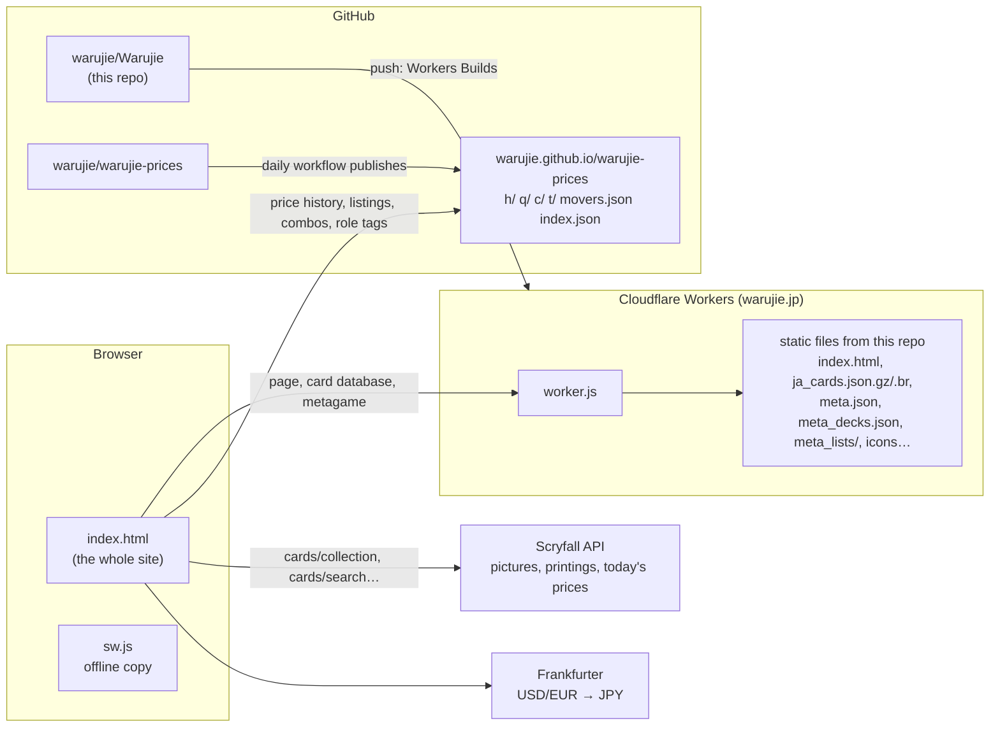

# Architecture

## The parts

| Part | What it is | Where |
|---|---|---|
| The page | One file with all HTML, CSS and JS. No framework, no build step, no npm packages. | [`index.html`](../index.html) |
| The preview page | `index.html` plus `noindex` and combo suggestions switched on. Generated; never edit it. | `preview.html`, made by `tools/make_preview.py` |
| The Worker | Compresses the HTML, serves the card database as brotli, writes link-preview tags for bots. | [`worker.js`](../worker.js), configured in [`wrangler.jsonc`](../wrangler.jsonc) |
| Offline copy | A network-first service worker so the installed app opens without a connection. | [`sw.js`](../sw.js) |
| Card database | About 33,800 cards with Japanese and English names, types and text. Searched in the browser. | `ja_cards.json.gz`, built by `tools/build_ja_database.py` |
| Metagame data | Deck shares, win rates, trends and sample lists, rebuilt daily. | `meta.json`, `meta_decks.json`, `meta_lists/`, built by `build_meta.py` |
| Price, combo and role data | Built daily in the second repository and published on GitHub Pages. | [warujie-prices](https://github.com/warujie/warujie-prices) |

There is no backend application, no database server, no accounts, no cookies and no analytics.
Everything the visitor sees is put together in their browser.

## What happens when someone opens the site

1. Cloudflare runs `worker.js` for `/` (and `/index.html`, `/preview*`). It fetches
   `index.html` from the static files, gzips it itself and marks it `no-transform` so Cloudflare
   doesn't inject its own scripts. If the visitor is a link-preview bot and the URL has
   `?card=`, `?view=deck` etc., it rewrites the title and `og:` tags first.
2. A small script in `<head>` applies the saved theme, language and lightweight mode before the
   page paints (no flash).
3. The main script starts. It reads the URL (`routeFromUrl()`) and shows the right view
   (`applyRoute()`): search/home, card, sets, metagame, deck or price movers.
4. Unless lightweight mode is on, it starts downloading the card database at once
   (`dbLoaded`, `fetchFirstData(DB_FILES)`). The Worker answers `/ja_cards.json` with the
   brotli file; anywhere else the page falls back to `ja_cards.json.gz` and unpacks it with the
   browser's `DecompressionStream`.
5. When the database is in (`loadCardDatabase()`), searches run locally. The role-tag file is
   fetched from warujie-prices (`loadTags()`) to add role search and popularity ordering.
6. Results show 30 cards at a time (`PAGE_SIZE`). Their pictures and today's prices come from
   Scryfall's `/cards/collection` (`hydrateRows()` → `scryfallCollection()`), at least 100 ms
   apart (`scryfallTurn()`), cached for the visit (`CARD_CACHE`).
7. The exchange rate comes from Frankfurter (`fetchJpyRate()`), so dollar and euro prices also
   show in yen.

If the card database can't load, the search falls back to Scryfall's live search API with
Japanese words translated to Scryfall syntax (`translateQuery()`, the "Japanese → Scryfall
translation layer"). That path is weaker and only a safety net.

## Outside services the browser talks to

| Service | Used for | In the code |
|---|---|---|
| `api.scryfall.com/cards/collection` | Pictures, prices, details of result cards; the printings a want list's lines name, by set and number | `scryfallCollection()`, `loadPrintCards()` |
| `api.scryfall.com/cards/search` | All printings of a card (card page, art picker); language buttons; set pages; the fallback search | `printEntries()`, `loadPrintCards()`, `printingLanguages()`, `setSearchUrl()`, `runSearch()` |
| `api.scryfall.com/cards/<id>`, `/cards/<set>/<number>/en` | Opening a card page directly; the English twin of a Japanese printing (for prices) | `fetchSingleCard()`, `priceHistoryId()` |
| `api.scryfall.com/sets`, `/catalog/creature-types`, `/cards/random` | Set list, creature-type filter, random cards without the database | `loadSets()`, filters section, `fetchRandomFromScryfall()` |
| `svgs.scryfall.io`, `cards.scryfall.io` | Mana symbols and card pictures | `symbolImg()`, `pictureTag()` |
| `warujie.github.io/warujie-prices/` | Price history `h/`, shop prices and listings `q/`, movers, combos `c/`, role tags `t/` | `PRICE_DATA_URL` |
| `api.frankfurter.dev` | USD→JPY and EUR→JPY (European Central Bank) | `fetchJpyRate()` |
| Google Fonts | Web fonts (not loaded in lightweight mode) | the `<head>` script |

Shop sites (Hareruya, Card Kingdom…) are **links only**; the page never reads them. The rules
about which outside data may be used are in CLAUDE.md, rule 3.

## Branches and deploys

| Branch | Goes to | Who pushes |
|---|---|---|
| `main` | **warujie.jp** (live) | Publishing only, plus the daily metagame commit and the name-readings bot |
| `staging` | `https://staging-warujie.warujie-mtg.workers.dev` (test site, noindex) | All normal work |
| any other branch | `https://<branch>-warujie.warujie-mtg.workers.dev` | Feature branches, backups |
| `backup-<date>-before-<what>` | a copy of the live site as it was before a publish | Made before each publish |
| `probe-shops` | none: a scratch branch whose workflow fetches outside data on GitHub's runners | See CLAUDE.md, "Reaching other websites" |

Cloudflare Workers Builds deploys every push. Before each deploy it runs
`node tools/brotli_db.mjs` (the `build` command in `wrangler.jsonc`), which makes
`ja_cards.json.br` and refuses to deploy a broken database. How to publish and roll back is in
[workflow.md](workflow.md).

## Scheduled jobs

| Job | When (UTC) | Repo | What it does |
|---|---|---|---|
| Update metagame data (`.github/workflows/update-meta.yml`) | daily 18:40 | this one, on `main` | Runs `build_meta.py`, commits `meta.json`, `meta_decks.json`, `meta_lists/` to `main` (which redeploys the site) |
| Name readings (`.github/workflows/name-readings.yml`) | when `ja_cards.json.gz` or the name tools change on `main`/`staging` | this one | Applies the Japanese name fixes and readings, commits back to that branch |
| Update price history (`update-prices.yml`) | daily 12:17 | warujie-prices | Builds prices, combos (weekly) and role tags (weekly), publishes to GitHub Pages without committing |

Every push to `staging` or `main` also runs **Docs match the code**
(`.github/workflows/check-docs.yml`), which only reads files (see
[workflow.md](workflow.md#keeping-these-docs-true)).

Because two bots commit to this repo, **pull before you commit** (`git pull --no-rebase` on
`staging`; publishing merges, never force-pushes `main`).
